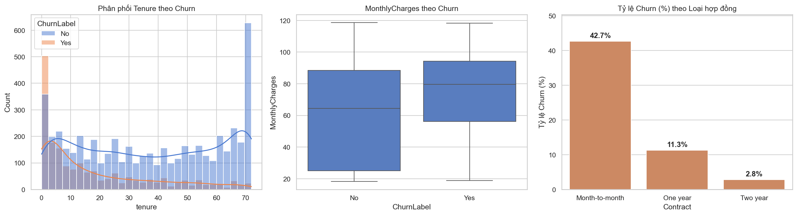
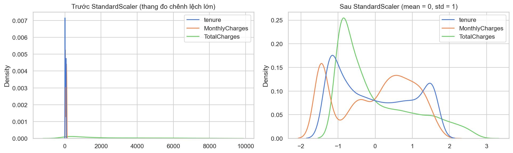
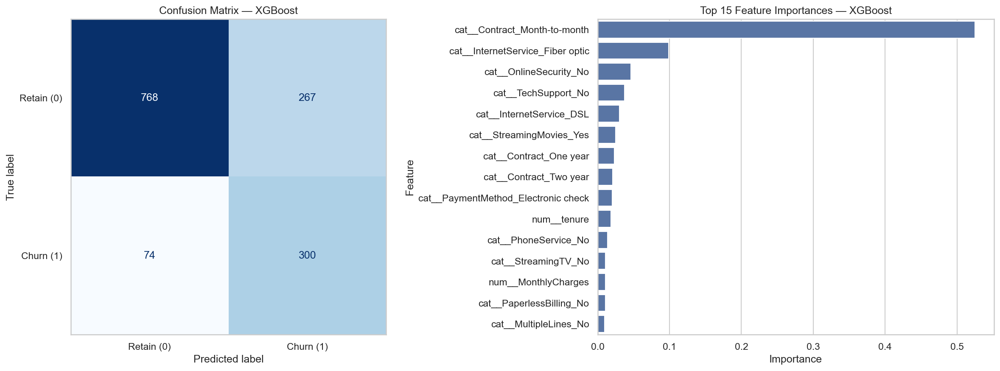

# 📊 Tổng Hợp & Phân Tích Biểu Đồ — Customer Churn Prediction

Tài liệu này lưu trữ toàn bộ 5 biểu đồ được sinh ra từ [notebooks/customer_churn_experiments.ipynb](file:///c:/Study/HK1Nam3/ML/Project/notebooks/customer_churn_experiments.ipynb) kèm phân tích chi tiết cho từng biểu đồ.

---

## 1. Phân phối biến mục tiêu (`Churn`)

### Phân tích:
- **Mức độ mất cân bằng lớp:** Trong tổng số **7,043** khách hàng, có **5,174** khách hàng ở lại (`No`, chiếm **73.5%**) và **1,869** khách hàng rời bỏ (`Yes`, chiếm **26.5%**), tương ứng tỷ lệ xấp xỉ **2.77 : 1**.
- **Hệ quả kỹ thuật:**
  - Nếu dùng *Accuracy* làm thước đo chính, một mô hình đoán tất cả là `No` vẫn đạt ~73.5% nhưng hoàn toàn vô dụng.
  - Bắt buộc phải chia tập train/test có phân tầng (`stratify=y`), áp dụng trọng số lớp (`scale_pos_weight` / `class_weight="balanced"`), và đánh giá bằng **ROC-AUC** cùng **Recall**.

---

## 2. Mối quan hệ giữa `tenure`, `MonthlyCharges`, `Contract` với `Churn`

### Phân tích:
- **`tenure` (Thời gian gắn bó):** Nhóm khách hàng rời bỏ có trung vị thời gian gắn bó chỉ **10 tháng**, thấp hơn gần 4 lần so với nhóm ở lại (**38 tháng**). Rủi ro rời bỏ tập trung cực cao ở giai đoạn 0–12 tháng đầu tiên.
- **`MonthlyCharges` (Cước hàng tháng):** Nhóm rời bỏ có trung vị cước phí là **79.65 USD/tháng**, cao hơn đáng kể so với **64.43 USD/tháng** của nhóm ở lại — cước phí cao tạo áp lực khiến khách hàng dễ chuyển sang đối thủ.
- **`Contract` (Loại hợp đồng):** Đây là yếu tố phân tách mạnh nhất:
  - `Month-to-month`: Tỷ lệ Churn lên tới **42.7%**.
  - `One year`: Giảm mạnh xuống **11.3%**.
  - `Two year`: Chỉ còn **2.8%**.

---

## 3. So sánh phân phối trước và sau `StandardScaler`

### Phân tích:
- **Trước `StandardScaler` (trái):** Vì `TotalCharges` có giá trị lên tới gần `9,000 USD`, trục hoành bị kéo giãn tới `10,000`, ép `tenure` (`0–72`) và `MonthlyCharges` (`18–118`) thành 2 vạch đứng sát gốc `0`. Nếu không chuẩn hóa, `TotalCharges` sẽ áp đảo hoàn toàn các biến khác trong mô hình tuyến tính.
- **Sau `StandardScaler` (phải):** Cả 3 biến được đưa về cùng một thang đo chuẩn quanh tâm `0` (trong khoảng `[-2, +3]`) mà **vẫn giữ nguyên hình dạng phân phối**:
  - `tenure`: phân phối 2 đỉnh (*bimodal*) ở nhóm khách mới (`z ≈ -1.2`) và lâu năm (`z ≈ +1.5`).
  - `MonthlyCharges`: phân 2 cụm rõ (gói cơ bản quanh `z ≈ -1.4` và gói cao cấp quanh `z ≈ +0.5` đến `+1.5`).
  - `TotalCharges`: lệch phải (*right-skewed*), tập trung ở mức chi tiêu thấp và kéo đuôi dài về phía `+3`.

---

## 4. Đường cong ROC so sánh 4 mô hình

### Phân tích:
- Cả 4 mô hình đều có đường cong ROC vươn cao về góc trên bên trái, vượt xa đường cơ sở đoán ngẫu nhiên (`AUC = 0.5000`).
- **Xếp hạng hiệu năng theo ROC-AUC:**
  1. **XGBoost:** **0.8435** *(cao nhất)*
  2. **Logistic Regression:** **0.8415**
  3. **Random Forest:** **0.8414**
  4. **LightGBM:** **0.8414**
- Dù cả 4 thuật toán đạt năng lực phân tách tương đối sát nhau (~0.84), **XGBoost** nhỉnh hơn cả về `ROC-AUC` (`0.8435`) lẫn `Recall` (`0.8021`), nên được chọn làm mô hình triển khai chính thức.

---

## 5. Ma trận nhầm lẫn & Top 15 Feature Importances (XGBoost)

### Phân tích:
- **Confusion Matrix (trái — tập test 1,409 mẫu):**
  - **TN = 768, FP = 267, FN = 74, TP = 300**.
  - Mô hình phát hiện đúng **300 / 374** khách hàng thực sự rời bỏ (**Recall = 80.21%**), chỉ bỏ sót 74 trường hợp. Số báo động giả (`FP = 267`) là sự đánh đổi chủ đích từ `scale_pos_weight` để tối ưu khả năng giữ chân khách hàng.
- **Top Feature Importances (phải):**
  - `cat__Contract_Month-to-month` chiếm tỷ trọng áp đảo (~**52.5%**), khẳng định hợp đồng theo tháng là tín hiệu rủi ro số 1.
  - Tiếp theo là `cat__InternetService_Fiber optic` (~**9.9%**), `cat__OnlineSecurity_No` (~**4.6%**), `cat__TechSupport_No` (~**3.7%**) và `cat__InternetService_DSL` (~**3.0%**).
  - Kết quả này khớp hoàn toàn với EDA và làm cơ sở cho các luật khuyến nghị can thiệp trong `app/service.py` (khuyến khích nâng cấp hợp đồng dài hạn và bổ sung dịch vụ bảo mật/hỗ trợ kỹ thuật).
